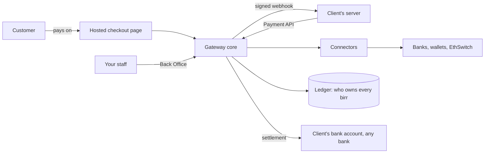

# Payment Gateway (Chapa-style)

**Status:** Draft v0.1 design. Phase 1 code has started in two services: the [gateway](gateway/README.md) in Java and the [orchestrator](orchestrator/README.md) in Go. The connectors are built by others.
**Date:** 2026-11-18

## What we are building

A payment gateway for Ethiopia, like Chapa:

- **Any customer can pay** a business from any bank or wallet.
- **The business gets its money** in any bank account.
- **Your staff control everything** in a Back Office: add banks and wallets, add clients (businesses), approve them, give them API keys, and see every payment.

## How the gateway works in one picture

The money moves in two legs. First it's **collected** from the customer's bank or wallet into our collection accounts. Then it's **paid out** to the client's bank. The ledger in the middle records who owns every birr. This is how "any bank to any bank" works, and it's how Chapa works too.

## Read in this order

| # | Document | What it answers |
|---|---|---|
| 1 | [Product and scope](docs/01-product-and-scope.md) | Who uses it, which features, what phase 1 includes |
| 2 | [Architecture](docs/02-architecture.md) | The parts of the system and how they fit together |
| 3 | [Banks, wallets and connectors](docs/03-banks-and-connectors.md) | How we connect to banks, and what "add a bank" really takes |
| 4 | [Payment flows](docs/04-payment-flows.md) | One payment from start to end, all payment methods, the hard cases |
| 5 | [Money and the ledger](docs/05-money-and-ledger.md) | Where the money is, every ledger entry, settlement and reconciliation |
| 6 | [Back Office](docs/06-back-office.md) | Every screen and action for your staff, roles, approvals |
| 7 | [APIs](docs/07-api.md) | Payment API, checkout API, provider callbacks, Back Office API, webhooks |
| 8 | [Data model](docs/08-data-model.md) | The six parts of the record (success candidates, successes, failures, the payments view, clients and banks) and every main table |
| 9 | [Security and compliance](docs/09-security-and-compliance.md) | Top risks and controls, licence and legal track |
| 10 | [Roadmap and decisions](docs/10-roadmap-and-decisions.md) | Phases, the decisions you need to make, changes to `../docs` |
| 11 | [A QR payment, step by step](docs/11-qr-payment-step-by-step.md) | One QR payment from scan to the client's bank: every message, status, ledger entry and Back Office line |
| - | [Research notes](research/research.md) | What we learned about Chapa and Ethiopia, with sources |

## Words we use

| Word | Meaning |
|---|---|
| **Client** | A business that collects payments through the gateway. `../docs` calls it a *merchant*. |
| **Customer** | The person who pays. |
| **Provider** | A bank, wallet, the national switch (EthSwitch) or a card processor that we connect to. |
| **Connector** | The code that talks to one kind of provider API. |
| **Collection account** | Our own bank account where customer money arrives. |
| **Payment session** | One payment request from a client, for one order and one exact amount. |
| **Attempt** | One try to pay a session with one method, for example telebirr. A session can have several attempts, but only one can succeed. |
| **Settlement** | Paying a client the money it collected, to its bank account. |
| **Payout** | Sending money from a client's balance to any bank account. |
| **Ledger** | Our book of every money movement, in double entry. |
| **Test mode / live mode** | Test mode uses fake money and test banks. Live mode moves real money. They never mix. |

## How this folder relates to `../docs`

- `../docs` is the full SuperApp design: a telebirr-style wallet, a marketplace and a Chapa-style gateway.
- **This folder is the gateway on its own, bank-first.** It keeps the rules already written in `../docs`: the [API conventions](../docs/core/api-conventions.md), the [accounting model](../docs/ledger/accounting-model.md), the [security plan](../docs/core/security-plan.md) and the [Payment API contract](../docs/payment-gateway/payment-api.openapi.yaml).
- **It changes one big thing:** the first release in `../docs` is built around our own wallet and one supermarket partner, with banks later. Here, banks and wallets come first, and our own wallet comes later.
- Nothing in `../docs` has been changed. The list of updates to make in `../docs` after you approve this design is in [section 10](docs/10-roadmap-and-decisions.md#changes-to-make-in-docs-after-approval).

## Open decisions

Eight decisions are waiting for you (tech stack, first real provider, bank access route, licence route, and more). They are listed with a recommendation for each in [Roadmap and decisions](docs/10-roadmap-and-decisions.md#decisions-to-make).

> Licence, fee and settlement figures in these documents come from public news and consultancy pages. Confirm them with the National Bank of Ethiopia and a lawyer before relying on them.
