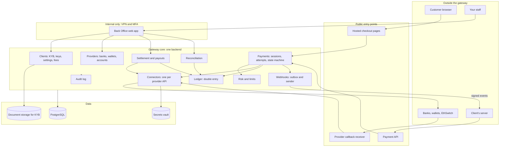
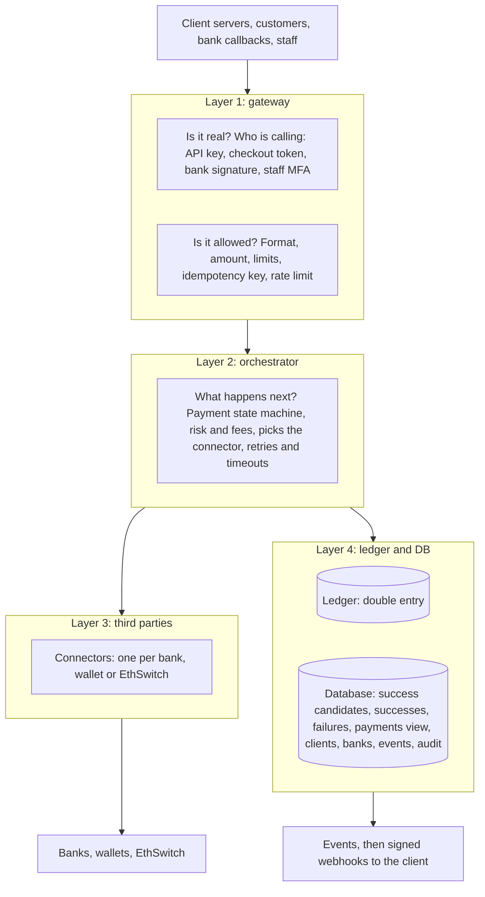
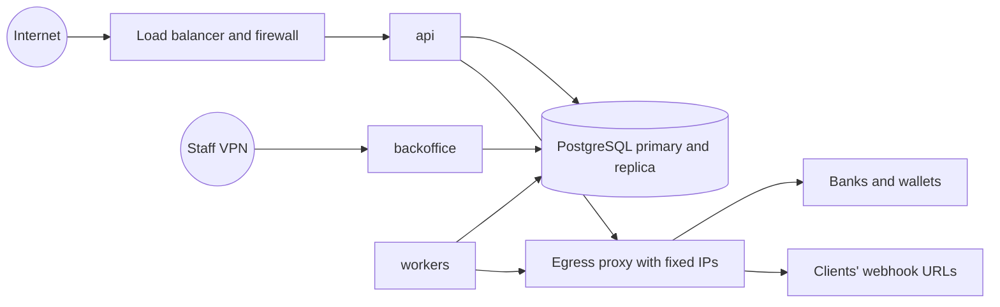

# 2. Architecture

**Part of:** [Payment Gateway design](../README.md)

## The big picture

## The four layers

Every request goes through the same four layers, from the outside in.

| Layer | Its job | Parts in it | It never |
|---|---|---|---|
| **1. Gateway layer** (the front door) | Lets in only real, allowed requests. It checks who is calling and that the request is correct, then passes it on. | Load balancer and firewall, Payment API, checkout API, bank callback receiver, the Back Office door; sign-in checks, request checks, rate limits, idempotency | Decides a payment result or moves money |
| **2. Orchestrator** (the brain) | Decides what happens next for every payment, and keeps the state machine | Payments (sessions, attempts, states), risk and limits, fees, refund and settlement rules, the workers that check pending payments | Talks to a bank directly (always through a connector), or changes old ledger entries |
| **3. Third parties** (connectors) | Talks to each bank or wallet in its own language, and turns the answer into our standard result | Connectors and provider records ([section 3](03-banks-and-connectors.md)) | Decides success alone, or writes to the ledger |
| **4. Ledger and database** (the record) | Keeps the record of everything | The [six parts](08-data-model.md#the-six-parts-of-layer-4): success candidates, successes, failures, the payments view, clients and banks. Also the ledger, outbox events, the audit log, and the vault for secrets. | Changes the past: a correction is always a new entry |

> **About the word "gateway".** The whole product is called a *payment gateway*. Layer 1 is the *API gateway*, the front door of that product.

### Two requests through the layers

**A client creates a payment:**
1. **Layer 1** checks the secret key, the request format and the idempotency key.
2. **Layer 2** creates the session and checks the client's limits.
3. **Layer 4** saves it as a success candidate (part 1).
4. The client gets the checkout link.

**A bank says "1,000 ETB arrived"** (step 5 of the [QR example](11-qr-payment-step-by-step.md)):
1. **Layer 1** checks the bank's signature and IP address.
2. **Layer 3**, the connector, reads the message and confirms it with the bank.
3. **Layer 2** matches it to the payment and decides `SUCCEEDED`.
4. **Layer 4** writes the success (part 2), ledger journal J1 and the webhook event in one transaction.
5. A worker sends the signed webhook to the client.

### Beside the layers

- **Events and webhooks:** the orchestrator writes events into the database (the outbox), and a worker sends them to clients.
- **Audit and monitoring:** every layer writes logs and audit entries with the same request ID, so one payment can be followed end to end.
- **Back Office:** staff come in through layer 1 too, by a separate door (VPN and MFA). Their actions follow layer 2 rules, such as the two-person rule. They never write to layer 4 directly.

## The parts

| Part | Its job | Data it owns |
|---|---|---|
| **Payment API** | The door for client servers: create a session, read it, verify, refund, balances | None (uses Payments and Clients) |
| **Hosted checkout** | The page where the customer picks a method and pays | None (uses Payments) |
| **Provider callback receiver** | Receives "payment done" messages from banks and wallets, checks they are real, and saves them | Raw callbacks |
| **Back Office** | The staff web app for banks, clients, payments, refunds, settlement, reconciliation and the audit log | Staff users, roles, approvals |
| **Clients** | Client records, KYB documents and review, status, API keys, fee plan, settlement bank account, allowed URLs | Clients, documents, keys, settings |
| **Providers** | Bank and wallet records, which methods each supports, our collection accounts there, limits, health | Providers, accounts |
| **Connectors** | One adapter per kind of provider API. They all follow the same interface ([section 3](03-banks-and-connectors.md#the-connector-interface-for-developers)). | Provider references, raw requests and responses (secrets masked) |
| **Payments** | Sessions and attempts, and the state machine. It is the only place that decides whether a payment succeeded. | Sessions, attempts, successes, failures, the payments view, refunds, idempotency keys ([data model](08-data-model.md#the-six-parts-of-layer-4)) |
| **Ledger** | The double-entry book of every money movement ([section 5](05-money-and-ledger.md)) | Accounts, journals, entries |
| **Settlement and payouts** | Daily settlement batches to clients' banks; payouts later | Batches, payouts |
| **Reconciliation** | Compares our records with bank and wallet statements every day | Statement imports, matches, suspense items |
| **Webhooks** | Saves every event in an outbox and sends it to the client, signed and retried | Events, deliveries |
| **Risk and limits** | Limits per client and per payment, velocity checks, blocked lists | Rules |
| **Audit** | Records every staff action and every money action, and can't be changed | Audit log |

## How one payment moves through the parts

1. The client's server calls the **Payment API**. **Payments** creates a session.
2. The customer opens **checkout** and picks a method. **Payments** creates an attempt and calls the right **connector**.
3. The connector talks to the bank or wallet. The result comes back as a reply, a callback or a status check.
4. In **one database transaction**, **Payments** writes the result as a success or a failure row, the **ledger** posts the journal (for a success), and **webhooks** saves the event in the outbox.
5. The webhook worker sends the event to the client.
6. Each day, **settlement** pays clients and **reconciliation** checks everything against the bank statements.

## Design rules

1. **The gateway decides payment results.** The customer's browser and the client's website never do.
2. **Every money movement is a ledger journal.** Nothing is edited or deleted. A correction is a new journal.
3. **The result, the ledger journal and the event are written together** in one database transaction, so they never disagree.
4. **Every call that creates something or moves money has an idempotency key**, so retries never charge twice.
5. **Connectors are plug-ins behind one interface.** Adding a bank never changes the payment logic.
6. **Test and live are fully separate:** keys, data, connectors and accounts.
7. **Secrets live in a vault**, never in code, config files or plain database columns.
8. **Every staff action is in the audit log.** Money actions need two people ([section 6](06-back-office.md#the-two-person-rule)).

## How it is deployed in phase 1

Following [ADR 002](../../docs/core/adr/002-deployment-shape.md), we start small, with one backend codebase that has strong module boundaries (a modular monolith). It runs in three ways:

| Unit | What runs in it | Who can reach it |
|---|---|---|
| **api** | Payment API, checkout backend, provider callbacks | Public internet, behind a load balancer, TLS and rate limits |
| **backoffice** | Back Office web app and its API | Staff only, through VPN, with MFA |
| **workers** | Webhook sender, pending-payment checker, session expiry, settlement batch, statement import | No inbound access |

- **Fixed outgoing IP addresses.** Banks usually allow calls only from IP addresses they know, and some ask for a VPN or a private line. All outgoing calls go through an egress proxy with fixed IPs. The same proxy blocks calls to private networks when we call clients' webhook URLs ([security plan section 4](../../docs/core/security-plan.md#4-registered-urls-and-ssrf-protection)).
- **Hosting in Ethiopia for live data**, as in [ADR 008](../../docs/core/adr/008-data-residency-retention-privacy.md).
- **Environments:** local, test (sandbox, for clients' developers), staging and live.
- **Backups:** point-in-time recovery, encrypted copies at a second site, and restore tests every month.

A part becomes its own service only when a measured need (load, release speed, isolation or a regulator) justifies it.

## Tech stack (decision D1)

| Option | Good | Less good |
|---|---|---|
| **Node.js with TypeScript, PostgreSQL** (recommended) | One language for the API, Back Office and checkout pages. Fast to build, and easy to hire for. | Must be strict about money types (integers only, no floating point). |
| **Java with Spring Boot, PostgreSQL** | Common in banks, strong tools for transactions | Slower to start, more code for the same features |

Both options use **PostgreSQL** for the ledger, as [ADR 005](../../docs/ledger/adr/005-ledger-and-accounting-controls.md) proposes. To keep the number of moving parts small, phase 1 needs no separate message broker: the outbox table in PostgreSQL drives the workers.
