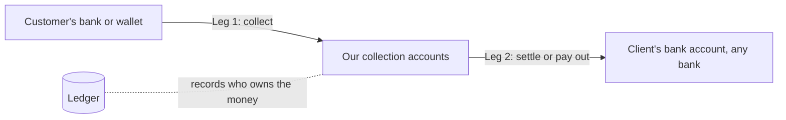

# 3. Banks, wallets and connectors

**Part of:** [Payment Gateway design](../README.md)

## How "any bank to any bank" really works

The gateway never moves money straight from the customer's bank to the client's bank. The money always moves in two legs:



1. **Collect.** The customer pays from their bank or wallet into one of our collection accounts.
2. **Record.** The ledger adds the money to the client's balance, minus our fee.
3. **Settle.** We pay the client from our collection account to its bank account, at any bank.

Chapa works this way too: it collects through each bank and wallet, keeps a balance for each business, and pays out to any bank ([research notes](../research/research.md#1-what-chapa-offers)).

## Three ways to reach banks and wallets

| Way | What it means | Good | Hard | When |
|---|---|---|---|---|
| **Direct, one by one** | A contract and an API connection with each bank or wallet (for example telebirr, CBE Birr, M-Pesa, a bank) | Works today. Best customer experience (phone push, SMS code). | One contract, one connector and one collection account for each provider | Phase 1, for the first one to three providers |
| **Through EthSwitch** (EthioPay-IPS), with a sponsor bank | One connection to the national switch. It reaches every member bank and wallet for QR payments, payment requests and transfers. | One integration covers almost every bank, for both collecting and paying out | Needs a sponsor bank and EthSwitch approval. Rules for companies that aren't banks must be confirmed. | Phase 3. Start the talks now. |
| **Through a licensed partner** | Use a licensed bank's or payment company's rails, under its licence | The fastest legal route to live | Less control, and we share revenue | A possible way to launch ([ADR 012](../../docs/wallet/adr/012-licensing-and-trust-account.md)) |

Ethiopian banks don't publish public developer APIs. Access comes through a business agreement with each bank, which then gives test credentials and documentation ([research notes](../research/research.md#4-banks-and-wallets)).

## Payment methods: how the customer approves

| Method | What the customer does | Examples (confirm with each provider) | How we learn the result |
|---|---|---|---|
| `push` | Types their phone number on our page, then approves a prompt on the phone with their PIN | telebirr, M-Pesa, CBE Birr, Ebirr, AwashBirr | Callback from the provider, then our status check |
| `otp` | Types an account or phone number, receives an SMS code, and types it on our page | Some banks and wallets (Chapa lists Amole) | The provider's reply |
| `redirect` | Goes to the bank's own page, signs in, approves, and comes back | Some banks (Chapa lists Enat Bank) | Callback, then our status check |
| `qr` | Scans a QR on our page with any bank app | Any EthioPay bank app, through EthSwitch (phase 3) | Notice from the sponsor bank or EthSwitch |
| `request_to_pay` | Types a phone or alias, then approves the request in their own bank app | EthioPay request-to-pay (phase 3) | Notice from the sponsor bank or EthSwitch |
| `bank_transfer` | Sends a transfer to our account with a unique reference | Any bank (later) | Match on the bank statement |
| `card` | Types card details in the processor's form and completes 3-D Secure | Visa, Mastercard (phase 4) | The card processor |

## What a provider record holds

This is what staff fill in under **Banks and wallets** in the Back Office ([section 6](06-back-office.md)).

| Field | Example | Why |
|---|---|---|
| Code | `TELEBIRR`, `CBE`, `AWASH` | Stable ID used in the API and the ledger |
| Display name and logo | "telebirr", English and Amharic | Shown on checkout |
| Type | bank, wallet, switch, card processor | Grouping and rules |
| Connector | `telebirr_v1`, `sandbox_push`, `ethswitch_ips` | Which adapter code talks to it |
| Methods | push, otp, redirect | What checkout can offer |
| Capabilities | collect, pay out, refund by API, status check, statements | What the system can do automatically |
| Credentials | A vault reference for test and one for live | Secrets never live in the database |
| Our collection account | Account number and name at this provider | Where customer money arrives |
| Payout source account | The account used to pay clients | For settlement and payouts |
| Limits | Minimum and maximum per payment | Provider rules |
| Our cost | The provider's fee to us, for example 0.5% | Ledger and profit |
| Settlement to us | For example T+1, cut-off time | When provider money reaches our bank |
| Status | `DRAFT`, `TESTING`, `ACTIVE`, `PAUSED`, `RETIRED` | Controls whether checkout shows it |
| Health | Error rate and response time | It pauses itself when the provider is failing |

```text
DRAFT -> TESTING -> ACTIVE <-> PAUSED
                       |
                       v
                    RETIRED
```

- `TESTING`: works in test mode only. It must pass the certification checklist below.
- `ACTIVE` in live mode needs a second staff member's approval.
- `PAUSED`: hidden from checkout. Staff can pause it, and so can the health check if the error rate gets too high. Payments already in progress still finish.

## Adding a bank: the real steps

1. **Business.** Sign an agreement with the bank (fees, settlement time, support). Open our collection account. Get test credentials. Give the bank our fixed IP addresses, and set up a VPN if they ask.
2. **Technology.**
   - If the bank uses a kind of API we already have a connector for, for example through EthSwitch, there's **no code**. Staff configure it in the Back Office.
   - If its API is new, a developer **writes its connector once**, following the interface below, and tests it against the bank's test system.
3. **Certification in test mode.** Run the checklist: success, wrong PIN or code, insufficient funds, timeout, pending then success, pending then failure, refund, payout, statement download.
4. **Go live.** A staff member asks to switch it to `ACTIVE` in live mode, and a second staff member approves. Set the limits.
5. **Turn it on for clients**, for all of them or one by one.

> The Back Office adds and controls banks. A bank with a new kind of API needs its connector written once, by a developer. After that, staff manage it without code.

## The connector interface (for developers)

Every connector does the same operations, so the payment logic never changes when we add a bank.

| Operation | What it does |
|---|---|
| `initiateCollection(attempt)` | Starts the payment at the provider. It returns the next step for the customer: push sent, enter OTP, go to a URL, or show a QR. |
| `submitOtp(attempt, code)` | Sends the customer's SMS code to the provider |
| `parseCallback(request)` | Checks a callback is real (signature, IP address) and turns it into a standard result |
| `getCollectionStatus(attempt)` | Asks the provider for the true status. It's used after every callback, and by the pending checker. |
| `refund(payment, amount)` | Refunds through the API, or answers "manual" if the provider has no refund API |
| `lookupAccountName(bank, account)` | Checks the name on an account before we pay money into it |
| `initiatePayout(payout)` / `getPayoutStatus(payout)` | Sends money to a bank account or wallet, and checks it |
| `fetchStatement(date)` | Downloads the provider's statement for reconciliation |
| `healthCheck()` | A quick check that the provider is up |

**Rules for every connector**

- Use **our attempt ID as the reference at the provider**, so a retry never creates a second charge.
- **Never trust a callback alone.** Check the signature, then confirm with `getCollectionStatus` before marking success.
- Set **short timeouts**. A timeout means "unknown" (`PENDING`), never "failed".
- **Translate provider errors** into our standard codes: `insufficient_funds`, `wrong_pin`, `declined`, `limit_exceeded`, `provider_unavailable`, `timeout`.
- Save **raw requests, responses and callbacks** with secrets and full account numbers masked.
- Every provider uses a different kind of security (for example RSA keys, encrypted fields or signed tokens). The connector handles it, and its keys come from the vault.

## Test providers for phase 1

These work only in test mode, so clients' developers can test every outcome without real money.

| Test provider | Method | Test input | Result |
|---|---|---|---|
| Test Wallet | `push` | `+251900000001`, PIN `1234` | Succeeds |
| | | `+251900000002` | Fails with `insufficient_funds` |
| | | `+251900000003` | Pending for 2 minutes, then succeeds |
| | | `+251900000004` | Pending, then fails |
| | | `+251900000005` | Wrong PIN, then locked |
| Test Bank | `otp` | Account `1000000001`, code `123456` | Succeeds |
| | | Account `1000000002` | Fails with `insufficient_funds` |
| | | Account `1000000003` | Pending, then succeeds |
| | | Any account, wrong code | Fails with `wrong_otp` after 3 tries |
| Test Redirect Bank | `redirect` | Approve or Decline button on the test bank page | Succeeds or fails |

The test wallet numbers are the same as in the [API conventions section 10](../../docs/core/api-conventions.md#10-sandbox).

## Moving money between our banks (treasury)

Money arrives in many banks, but each client wants it in its own bank. So finance needs a daily view of:

- each collection account's balance compared with what we must pay out from it;
- transfers between our own accounts (through EthSwitch or a bank transfer), recorded in the ledger as moves between `collection_bank` accounts;
- an alert when an account doesn't have enough money for the day's settlements.

The settlement job picks, for each payment to a client, the account that has the money. It pays from the same bank when it can, because that's usually cheaper and faster.
