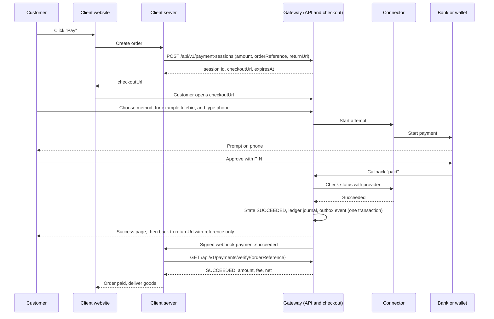
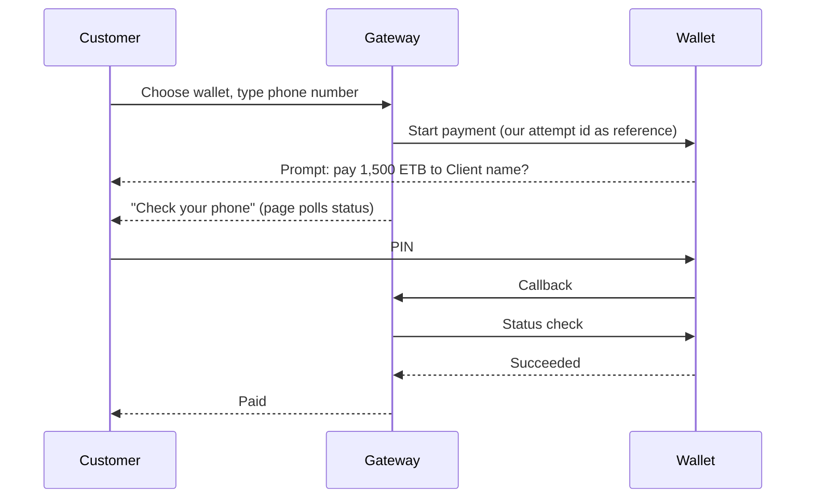
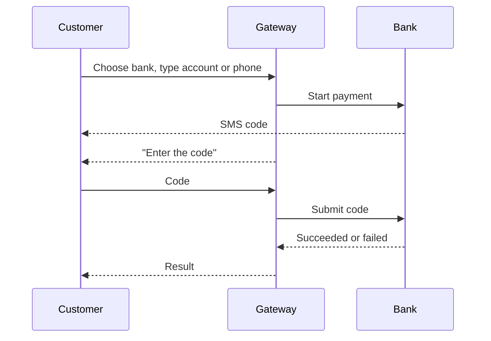
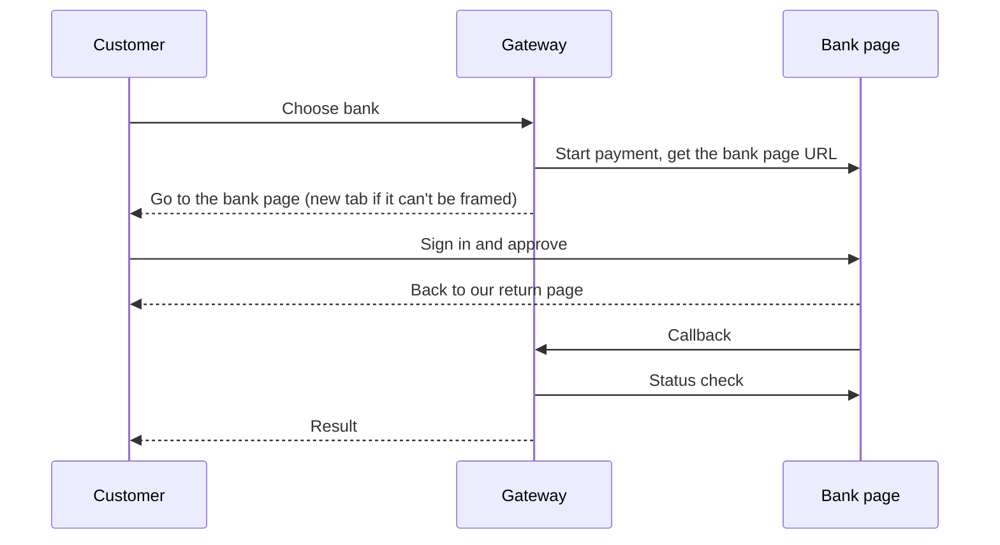
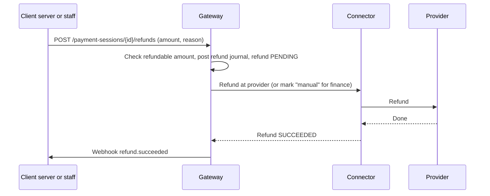
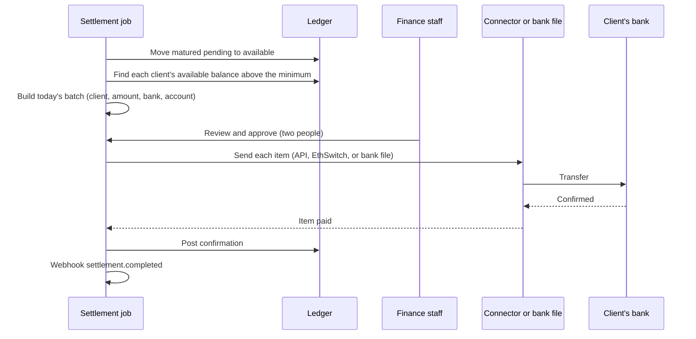

# 4. Payment flows

**Part of:** [Payment Gateway design](../README.md)

## 4.1 One payment from start to end



In plain words:

1. The client's **server** (never the browser) creates the session with the exact amount. Nobody can change the amount after that.
2. The customer pays on **our** checkout page, so the client never sees bank or wallet details.
3. We learn the result from the provider and **confirm it ourselves** with a status check.
4. The client learns the result from the **signed webhook** and confirms it with the **verify API** before delivering goods.
5. The customer's return to the client's website carries **only a reference**, never "success", because a browser can be faked.

## 4.2 What the customer sees on checkout

```text
+------------------------------------------+
|  [Client logo]  Client name              |
|  Pay 1,500.00 ETB   Order ORDER_10001    |
|------------------------------------------|
|  Choose how to pay                       |
|   ( ) telebirr                           |
|   ( ) M-Pesa                             |
|   ( ) CBE Birr                           |
|   ( ) Bank account  [choose bank v]      |
|   ( ) Any bank app (QR)    [phase 3]     |
|                                          |
|              [ Pay 1,500.00 ETB ]        |
|  Secured by <our brand>   Expires 14:59  |
+------------------------------------------+
```

The result screens are **Paid**, **Waiting for confirmation** (pending), **Failed, try another way** and **Expired**. Each shows the reference and a support contact. The page is in English and Amharic.

## 4.3 Each payment method

### Push (wallets)



If nothing comes back within the prompt time (usually about 2 minutes), the attempt becomes `PENDING`, and the pending checker keeps asking the provider.

### OTP (bank account or wallet with an SMS code)



The customer gets 3 tries for the code. After that, the attempt fails and they can start again or choose another method.

### Redirect (the bank's own page)



### QR and payment request through EthSwitch (phase 3)

Checkout shows a one-time EthioQR code for the exact amount and reference, linked to our collection account. The customer scans it with **any** bank app and approves. The sponsor bank or EthSwitch tells us the money arrived, and we match it by reference. A payment request works the same way, but the customer types their phone or alias and approves the request in their own bank app.

[Section 11](11-qr-payment-step-by-step.md) follows one QR payment through every step, from the scan to the money arriving in the client's bank.

## 4.4 States

### Payment session

These states come from the [architecture section 6.1](../../docs/core/architecture.md#61-payment-session-states-payment-gateway), with one change: a failed try doesn't end the session, so the customer can try another way.

```text
CREATED -> AUTHORIZATION_REQUIRED -> PROCESSING -> SUCCEEDED
                                         |-------> PENDING -> SUCCEEDED
PROCESSING or PENDING -> AUTHORIZATION_REQUIRED   (the try failed and time is left)
CREATED or AUTHORIZATION_REQUIRED -> EXPIRED      (time passed expiresAt)
CREATED or AUTHORIZATION_REQUIRED -> FAILED       (the customer cancelled)
SUCCEEDED -> REFUNDED                             (when refunds reach the full amount)
```

- **Where the status lives:** the database doesn't keep the session status in a column. The [payments view](08-data-model.md#part-4-the-payments-view) works it out from the success and failure tables, so the status can never disagree with them.
- `FAILED` and `EXPIRED` are final, as in the architecture. A session whose time passes while a try is still running ends `EXPIRED` only after that try has failed.

- `VERIFYING` is in the architecture for marketplace partners whose orders we check with them first. Gateway-only clients skip it.
- `PENDING` is a real state. It's settled only by a status check with the provider or by reconciliation, never by the browser.
- A session can be paid **once**. A session in `PROCESSING` or `PENDING` doesn't expire, because money may be moving.
- **Proposed fix to the docs (decision D8):** the architecture also lists `REFUNDING` and `REFUND_FAILED` as session states. That conflicts with partial refunds, because a session can be refunded several times. We propose that the session stays `SUCCEEDED` with `amountRefunded` growing, and each refund has its own status (`PENDING`, `SUCCEEDED`, `FAILED`), as in the [OpenAPI contract](../../docs/payment-gateway/payment-api.openapi.yaml). The session becomes `REFUNDED` only when the full amount is refunded.

### Attempt

```text
CREATED -> ACTION_REQUIRED -> PROCESSING -> SUCCEEDED
                                  |-------> PENDING -> SUCCEEDED or FAILED
                                  |-------> FAILED
ACTION_REQUIRED -> EXPIRED  (customer did not approve in time)
```

A session can have several attempts. For example, telebirr fails, then the bank succeeds. **At most one attempt can succeed**, and the database enforces this. The end of each attempt is a new row in the [success or failure table](08-data-model.md#parts-1-to-3-payments).

## 4.5 Hard cases

| What happens | What the gateway does |
|---|---|
| The customer closes the browser after approving | Nothing is lost. The callback or the pending checker settles the attempt, and the client still gets the webhook. |
| The customer double-clicks Pay | The second click returns the same attempt. Nothing is charged twice. |
| The client's server retries a session create | The same `Idempotency-Key` returns the same session ([API conventions section 6](../../docs/core/api-conventions.md#6-idempotency)). |
| **Two attempts both succeed** (the customer pays by telebirr, then also by bank) | The first success wins. The second is refunded automatically and flagged for staff. |
| The callback never comes | The pending checker asks the provider at 30 s, 2 min, 10 min and 1 h, then every hour up to 24 h ([ADR 004](../../docs/payment-gateway/adr/004-payment-state-machine-and-reconciliation.md)). After that it goes to daily reconciliation. It is never failed automatically while money may have moved. |
| The callback says "paid" but the status check says "failed" | We trust the status check and flag the attempt for review. |
| The provider reports success after we marked the attempt failed | Reconciliation finds it. The money is refunded to the customer (or the session is corrected if it's still open), with an alert. |
| The provider pays less than the amount | The attempt fails, the money is refunded, and it goes to suspense if needed. |
| The client's webhook URL is down | We retry at 1 min, 5 min, 30 min, 2 h, 6 h and 12 h, then daily up to 3 days. Staff can resend it from the Back Office. |
| A provider is down | The health check pauses it, checkout hides it, and payments in progress still finish. |
| A session expires while the customer is still choosing | The page shows "Expired". The client creates a new session for the same order. |

## 4.6 Refund



- Partial refunds are allowed until the total equals the payment.
- A refund started by **staff** needs a second staff member's approval. A refund started by the **client with its API key** does not.
- If the provider has no refund API (for example telebirr, as reported), finance sends the refund by hand and marks it done in the Back Office.

## 4.7 Daily settlement to clients



In phase 1, finance sends the batch with a bank file or the bank's portal and marks the items paid. Automatic sending comes with the first bank that offers a payout API, and with EthSwitch in phase 3.

## 4.8 Payouts (phase 2)

A payout is like Chapa's "transfer": the client sends money from its available balance to any bank account. The steps are:

1. **Name check.** We check the account name with `lookupAccountName` before sending.
2. **Approval.** The client's owner approves each payout in the Merchant Dashboard with an OTP, or the client's server approves it at a registered approval URL with a signed request. Chapa offers both ([research notes](../research/research.md#1-what-chapa-offers)).
3. **Limit.** A payout can never be more than the available balance.
4. **Status.** Payouts move through `QUEUED`, `PROCESSING`, then `SUCCEEDED`, `FAILED` or `REVERSED`, with a webhook for each final state.
