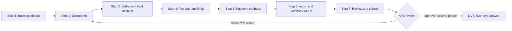
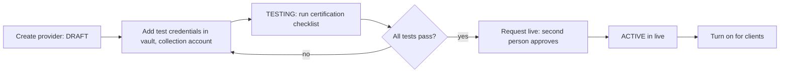

# 6. Back Office

**Part of:** [Payment Gateway design](../README.md)

The Back Office is the web app your staff use to run the gateway: add banks and wallets, add and approve clients, watch payments, handle refunds, pay clients and check the money. It's for internal use only, behind a VPN, with MFA for every staff member.

## Roles

| Role | What they can do |
|---|---|
| **Admin** | Manage staff users and roles, and system settings. Can't approve their own money actions. |
| **Operations** | Add and edit banks and wallets, add and edit clients, turn payment methods on for clients |
| **KYB reviewer** | Review client documents, approve or reject clients, set the risk level |
| **Finance** | Settlement batches, payouts, reconciliation, treasury, approve refunds and money corrections |
| **Support** | Search payments, check a status now, resend webhooks, request a refund (finance approves) |
| **Auditor** | Read everything, including the audit log. Can't change anything. |

A person can have more than one role, but never both "prepare" and "approve" on the same action.

## The two-person rule

These actions need one person to prepare them and a **different** person to approve:

| Action | Prepared by | Approved by |
|---|---|---|
| Refund started by staff | Support or Finance | Finance |
| Switching a provider to `ACTIVE` in live mode | Operations | Admin or Finance |
| Approving a client for live mode | KYB reviewer | A second KYB reviewer or Admin |
| Changing a client's settlement bank account | Operations | Finance, after the name check |
| Changing a fee plan, limits or risk rules | Operations | Finance or Admin |
| Sending a settlement batch | Finance | A second Finance person |
| Resolving a suspense item or a manual journal | Finance | A second Finance person |

Every request and approval is written to the audit log with the values before and after.

## Screens

| # | Screen | What staff do there |
|---|---|---|
| 1 | **Home** | Today's volume and success rate per provider, pending payments, failed webhooks, approvals waiting, alerts |
| 2 | **Banks and wallets** | List and add providers, fill in the [provider record](03-banks-and-connectors.md#what-a-provider-record-holds), test the connection, manage collection accounts, set limits, pause, request go-live |
| 3 | **Clients** | List and search clients, add a client (wizard below), review KYB, set the risk level, suspend or close |
| 4 | **Client detail** | Business info, documents, status history, fee plan, methods turned on, settlement account, return URLs and webhook URL, API keys, webhook secret, balances, payments, settlements |
| 5 | **Payments** | Search by reference, client, provider, status or date. The detail page shows the attempts timeline, provider references, ledger journals, webhook deliveries and raw callbacks (masked). Actions: check status now, resend webhook, request refund. |
| 6 | **Refunds** | Refund requests waiting for approval, and refund status |
| 7 | **Settlements** | Today's batch: each client, amount, bank and account. Review, approve, send or export the bank file, mark paid, handle failures. |
| 8 | **Payouts** (phase 2) | Clients' payouts and their status |
| 9 | **Reconciliation** | Upload or fetch statements, see matched and unmatched items, work on the suspense list |
| 10 | **Ledger** | Account balances, journals, and the [automatic checks](05-money-and-ledger.md#automatic-checks) as green or red |
| 11 | **Treasury** | Each collection account's balance compared with what we must pay from it today, and transfers between our accounts |
| 12 | **Fee plans** | Fee plan templates and which clients use them |
| 13 | **Settings** | Banned and restricted business types, default limits, risk rules, settlement cut-off, holidays |
| 14 | **Staff and roles** | Staff users, roles, MFA status |
| 15 | **Audit log** | Every staff action and money action, searchable |
| 16 | **Reports** | Monthly client statements, regulator reports, data exports |

## Adding a client



1. **Business details:** legal name, trade name, business type, TIN, trade licence number, address, contact person, website or app.
2. **Documents (KYB):** trade licence, TIN certificate, owner ID, and proof of the bank account in the business's legal name. The checklist follows [ADR 011](../../docs/payment-gateway/adr/011-gateway-eligibility-external-merchants.md).
3. **Settlement bank account:** bank, account number and name. The name must match the legal name; we check it with the bank when a name lookup is available.
4. **Fee plan and limits:** a template or a custom plan, and limits per payment, per day and per month.
5. **Payment methods:** which banks and wallets this client can offer on checkout.
6. **URLs:** allowed return URLs and the webhook URL, HTTPS only, checked as in the [security plan section 4](../../docs/core/security-plan.md#4-registered-urls-and-ssrf-protection).
7. **Review and submit:** test keys are available at once. Live keys come only after approval.

### Client statuses

These come from the [Payment Gateway module](../../docs/payment-gateway/payment-gateway.md#state-it-owns).

```text
SIGNED_UP -> KYB_SUBMITTED -> KYB_REVIEW -> LIVE
                                  |           |
                                  v           v
                           back to SIGNED_UP  SUSPENDED -> LIVE (reinstated)
                           (rejected, reason)     |
                                                  v
                                                CLOSED
```

- Until `LIVE`, a client can use test mode only.
- `SUSPENDED` stops new sessions and settlements at once. Old records stay visible.
- Every client gets a risk level (low, medium or high), which sets its limits, settlement delay and reserve ([ADR 011](../../docs/payment-gateway/adr/011-gateway-eligibility-external-merchants.md)).

### API keys

- Each client has **secret keys** for test (`sk_test_...`) and live (`sk_live_...`), plus a **webhook secret** for each mode.
- A key is **shown once** when it's created, and then only its last four characters. We store only a hash of it.
- Two active keys per mode are allowed, so a client can switch to a new key without downtime. Revoking a key works within 60 seconds.
- Details are in the [security plan section 2](../../docs/core/security-plan.md#2-merchant-api-keys).

## Adding a bank or wallet

Adding a bank or wallet follows the five steps in [section 3](03-banks-and-connectors.md#adding-a-bank-the-real-steps): business agreement, technology, certification, go live, turn on for clients. In the Back Office, it looks like this:



## Security for the Back Office

- Staff sign in with MFA (an authenticator app or a security key), only through the VPN and from company devices.
- Sessions end after 8 hours, and money actions ask for MFA again ([ADR 003](../../docs/core/adr/003-authentication-and-token-model.md)).
- Staff can't change a ledger balance directly. Every change is a journal through the two-person rule.
- Staff see masked customer data (for example `+2519****1234`) unless their role needs more, and every view of full data is logged.
