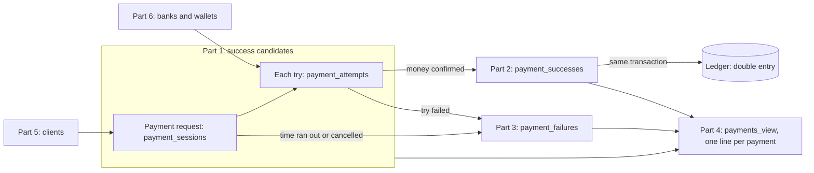
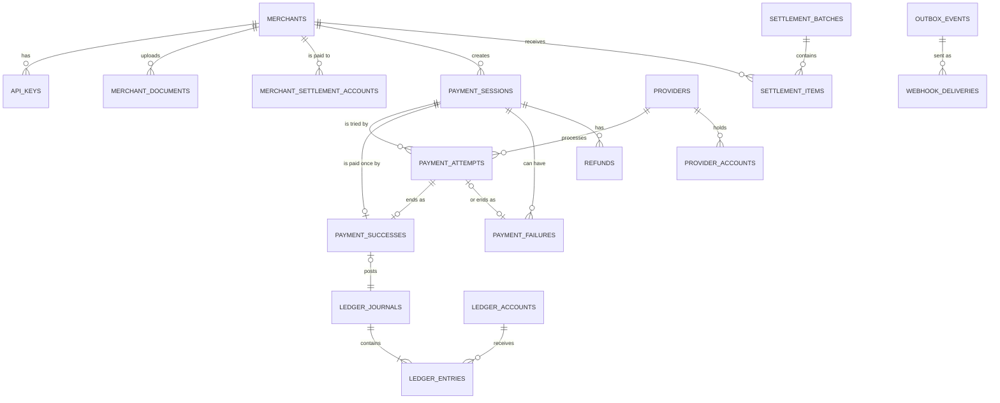

# 8. Data model

**Part of:** [Payment Gateway design](../README.md)

These are the main tables in PostgreSQL. Technical names use **merchant**, as `../docs` does. In plain words, a merchant is a **client**.

Rules for every table:

- Money is `bigint` santim plus a `currency` column. There are no floating-point numbers anywhere.
- Every business table has a `mode` column (`test` or `live`). Test and live rows never mix, and every query filters by mode.
- IDs carry a type prefix: `ps_` session, `att_` attempt, `suc_` success, `fail_` failure, `rf_` refund, `po_` payout, `evt_` event.
- Sensitive columns (account numbers, customer hints, documents) are encrypted, and the keys are in the vault.

## The six parts of layer 4

Layer 4 of the [four layers](02-architecture.md#the-four-layers) keeps the record. It has six parts:

| Part | What it holds | Tables | A new row is written when |
|---|---|---|---|
| **1. Success candidates** | Every payment request from a client, and every try to pay it | `payment_sessions` and `payment_attempts` | A client's server creates a payment, and each time the customer tries a method |
| **2. Successes** | Payments where the money arrived and we confirmed it with the bank | `payment_successes` | A status check, or reconciliation, confirms the money |
| **3. Failures** | Tries that failed, and payments that ended without money | `payment_failures` | The bank says no, the time runs out, or the customer cancels |
| **4. The view** | One line per payment, with its current status | `payments_view` | Never. A view stores nothing. It's worked out from parts 1 to 3 each time it's read. |
| **5. Clients** | Every business that collects payments | `merchants` | Staff add a client in the Back Office |
| **6. Banks** | Every bank, wallet and EthSwitch connection | `providers` | Staff add a bank or wallet in the Back Office |



### Why this shape is good

- **A result is never changed.** Parts 2 and 3 only get new rows. Nobody can quietly turn a failure into a success, or a success into a failure.
- **The database enforces the most important rule.** A payment can have only one row in part 2, so it can never be paid twice.
- **Finance reads part 2 directly.** Settlement and reconciliation start from confirmed money only.

### Four rules that make it work

1. **One success, many failures.** A customer can fail with telebirr and then pay by bank. So a failure row usually means "this try failed", and the payment stays open until it's paid or its time runs out. A failure row with no try in it means the whole payment ended without money.
2. **Pending is not a table.** A try that is still running has no row in part 2 or part 3 yet. The view shows it as `PROCESSING` or `PENDING`, and the pending checker keeps asking the bank.
3. **A success always comes with a ledger journal.** Part 2 says the payment worked. The [ledger](05-money-and-ledger.md) says where every birr is now, for example 985 ETB for the client and a 15 ETB fee for us. The success row, the ledger journal and the webhook event are written in one database transaction, so they never disagree.
4. **A try can move forward until it ends.** While a try is running, its row in part 1 can change its step, for example from "waiting for the PIN" to "waiting for the bank". Once its result is in part 2 or part 3, the try is locked.

## Main relationships



## Parts 1 to 3: payments

```text
payment_sessions     id, merchant_id, mode, order_reference, amount, currency, description,
                     customer_hint_enc, return_url, webhook_url, metadata, expires_at, created_at
payment_attempts     id, session_id, method, provider_id, payer_masked, provider_ref,
                     step (ACTION_REQUIRED | PROCESSING | PENDING), next_action, otp_tries,
                     created_at, updated_at
payment_successes    id, session_id, attempt_id, amount, fee, net, provider_ref,
                     confirmed_by (status_check | reconciliation), journal_id,
                     corrects_failure_id, approval_id, confirmed_at
payment_failures     id, session_id, attempt_id (empty when the whole payment ended), reason,
                     provider_code, failed_at
provider_callbacks   id, provider_id, received_at, headers_masked, body_masked,
                     signature_valid, attempt_id, processed_at
idempotency_keys     merchant_id, mode, endpoint, key, request_hash, response, status, expires_at
refunds              id, session_id, amount, status, reason, requested_by (api | staff),
                     approval_id, provider_ref, created_at
```

`payment_sessions` has no `status` column. The status comes from [the view](#part-4-the-payments-view).

Failure reasons:

| Reason | Meaning | Ends the whole payment? |
|---|---|---|
| `DECLINED` | The bank or wallet said no, for example because there wasn't enough money | No. The customer can try again. |
| `OTP_FAILED` | The customer typed a wrong code 3 times | No |
| `NOT_APPROVED` | The bank confirms the customer didn't approve in time | No |
| `AMOUNT_MISMATCH` | The bank paid a different amount. That money is refunded. | No |
| `EXPIRED` | The payment's time ran out with no success | Yes |
| `CANCELLED` | The customer cancelled on the checkout page | Yes |

Important database rules:

- **Paid only once:** `payment_successes.session_id` is unique.
- **One result per try:** `attempt_id` is unique in `payment_successes` and in `payment_failures`, and a check stops one try from having both. The only exception is a correction from reconciliation (below).
- **Results are written once:** the application's database user has no `UPDATE` or `DELETE` rights on `payment_successes` and `payment_failures`, the same as the ledger.
- **The right amount:** a check rejects a success whose amount is not the session's amount.
- **Paid means paid:** a check rejects an `EXPIRED` or `CANCELLED` row for a session that already has a success.
- **No expiry while money may be moving:** the expiry job skips a session that has a running try.
- **A try is locked once it has a result:** its step only moves forward (`ACTION_REQUIRED`, then `PROCESSING`, then `PENDING`), and a check rejects any change to the try after its result is written.
- **Late money after a failure:** reconciliation may find that the bank took the money for a try we recorded as failed. If the payment is still open, we add a success row that points to that failure (`corrects_failure_id`), approved by two people, and the failure row stays as it was. If the payment already ended, or was paid another way, the money goes to suspense and is refunded ([hard cases](04-payment-flows.md#45-hard-cases)).
- **Idempotency:** the primary key is `(merchant_id, mode, endpoint, key)`.
- `customer_hint_enc` is deleted after 90 days ([security plan section 9](../../docs/core/security-plan.md#9-data-retention-and-deletion)).

## Part 4: the payments view

`payments_view` shows one line per payment. It joins parts 1 to 3 with the refunds, and it stores nothing itself. The Payment API, the checkout page and the Back Office all read the status from it, so everyone sees the same answer.

Its columns are: session id, client, mode, order reference, amount, status, the method and bank of the paid try, paid at, fee, net, amount refunded, number of tries, last failure reason, and expires at.

It works out the status like this. The first line that fits wins.

| What the tables hold | Status shown |
|---|---|
| A success, and refunds that add up to the full amount | `REFUNDED` |
| A success | `SUCCEEDED` |
| A failure that ended the payment because its time ran out | `EXPIRED` |
| A failure that ended the payment for another reason, for example the customer cancelled | `FAILED` |
| A running try at step `PENDING`: the bank hasn't answered in time, and the pending checker is asking it | `PENDING` |
| A running try at step `PROCESSING`: we're waiting for the bank | `PROCESSING` |
| A running try at step `ACTION_REQUIRED`: we're waiting for the customer's PIN, code or bank page | `AUTHORIZATION_REQUIRED` |
| No running try, the last try failed, and time is left | `AUTHORIZATION_REQUIRED`, with the reason, so checkout shows "Failed, try another way" |
| No try yet | `CREATED` |

These are the same status names as in the [Payment API](07-api.md) and the [state diagrams](04-payment-flows.md#44-states), so nothing changes for clients. `FAILED` stays final, as in the architecture. A payment with partial refunds stays `SUCCEEDED`, as decision D8 proposes.

**Speed.** In phase 1 the view is worked out on every read. That is fast with an index on `session_id` in each table. If it gets slow when there are millions of payments, we can add a status cache that the same transaction writes, the way `account_balances` caches the ledger. Parts 1 to 3 stay the source of truth.

## Part 5: clients (merchants)

Part 5 holds the businesses. These documents use "customer" for the person who pays, so the businesses are called clients.

```text
merchants                     id, legal_name, trade_name, category, tin, trade_licence_no,
                              risk_level (low | medium | high), status, created_at
merchant_documents            id, merchant_id, type, file_ref, sha256, review_status,
                              reviewed_by, reviewed_at, reason
merchant_settings             merchant_id, mode, fee_plan_id, limit_per_payment, limit_daily,
                              limit_monthly, settlement_delay_days, branding, webhook_url,
                              return_url_allowlist
merchant_settlement_accounts  id, merchant_id, bank_provider_id, account_number_enc, account_name,
                              verified_name, status, active_from, approved_by
merchant_methods              merchant_id, mode, provider_id, method, enabled
fee_plans                     id, name, rules (per method: percent in basis points, fixed, min, max),
                              refund_fee_policy
api_keys                      id, merchant_id, mode, type (secret | public | webhook), key_hash,
                              last4, status, created_at, revoked_at
```

## Part 6: banks and wallets (providers)

Part 6 holds every bank, wallet and EthSwitch connection. They share one table, `providers`, with a `type` column.

```text
providers                id, code, name_en, name_am, type (bank | wallet | switch | card),
                         connector, status, capabilities, min_amount, max_amount,
                         cost_rule, settlement_terms
provider_methods         provider_id, method (push | otp | redirect | qr | request_to_pay), enabled
provider_credentials     provider_id, mode, vault_ref, rotated_at
provider_accounts        id, provider_id, mode, purpose (collection | payout), account_number_enc,
                         account_name, ledger_account_id
provider_health          provider_id, window_start, requests, errors, p95_ms
```

## Ledger

Parts 1 to 4 say what happened to each payment. The ledger says where the money is and who owns it ([section 5](05-money-and-ledger.md)). Every success row points to its ledger journal (`journal_id`).

```text
ledger_accounts     id, code (for example merchant:123:pending), type, currency, mode
ledger_journals     id, source_event_id (unique), type, mode, value_date, posted_at,
                    reverses_journal_id
ledger_entries      id, journal_id, account_id, direction (debit | credit), amount, currency
account_balances    account_id, balance, updated_at   (a cache, rebuilt from entries)
```

- A check at commit rejects any journal whose debits don't equal its credits.
- The application's database user has **no `UPDATE` or `DELETE` rights** on ledger tables ([ADR 005](../../docs/ledger/adr/005-ledger-and-accounting-controls.md)).

## Settlement and payouts

```text
settlement_batches   id, mode, value_date, status, prepared_by, approved_by
settlement_items     id, batch_id, merchant_id, amount, destination_account_id,
                     source_provider_account_id, status, provider_ref
payouts              id, merchant_id, mode, bank_provider_id, account_number_enc, account_name,
                     amount, fee, status, approval_method, provider_ref   (phase 2)
```

## Reconciliation

```text
statement_imports        id, provider_account_id, statement_date, source (api | file),
                         file_ref, imported_by
statement_lines          id, import_id, line_ref, amount, direction, value_date, description
reconciliation_matches   id, statement_line_id, object_type, object_id, status
suspense_items           id, reason, amount, owner, opened_at, status, resolved_journal_id
```

## Events and webhooks

```text
outbox_events        id, merchant_id, mode, type, payload, created_at, published_at
webhook_deliveries   id, event_id, attempt_no, response_code, duration_ms, next_retry_at, status
```

An event is written in the **same transaction** as the result it describes. The worker reads the outbox and delivers.

## Staff, approvals and audit

```text
staff_users    id, email, name, status, mfa_enabled
staff_roles    staff_id, role
approvals      id, action_type, object_type, object_id, payload, requested_by, approved_by,
               status, created_at, decided_at        (check: requested_by <> approved_by)
audit_logs     id, actor_type, actor_id, action, object_type, object_id, before_data,
               after_data, ip, correlation_id, created_at   (append only)
```
