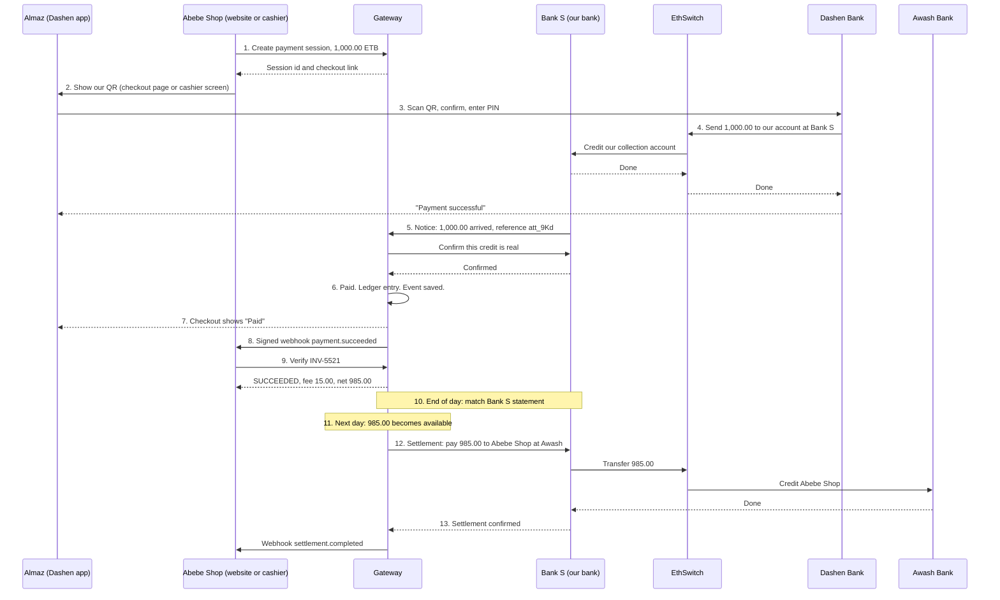

# 11. A QR payment, step by step

**Part of:** [Payment Gateway design](../README.md)

This page follows **one QR payment** from the moment the customer scans our QR until the money is in the client's bank account. It shows every message between the systems, every status change, every ledger entry, and what each person sees.

> QR payments from any bank app need EthSwitch (EthioPay-IPS) access through a sponsor bank, which is **phase 3** ([section 3](03-banks-and-connectors.md#three-ways-to-reach-banks-and-wallets)). The exact message formats and QR fields must be confirmed with EthSwitch and the sponsor bank. Everything else on this page (statuses, ledger, webhooks, settlement, Back Office) works the same for every payment method.

## The example

| Who | In this example |
|---|---|
| **Customer** | Almaz. She has an account at **Dashen Bank** and uses the Dashen app. |
| **Client** | **Abebe Shop**. Its settlement account is at **Awash Bank**. |
| **The gateway** | Us |
| **Our sponsor bank** | **Bank S**. It holds our collection account and connects us to EthSwitch. |
| **EthSwitch** | Moves the money between Dashen and Bank S in seconds |
| **Amount** | 1,000.00 ETB. Our fee is 1.5% = 15.00, so the client gets 985.00. |

## The whole journey in one picture



## Every step

| # | When | What happens | Message (from → to) | Status after | Ledger |
|---|---|---|---|---|---|
| 0 | Once, before | Staff add "EthioPay QR" as a provider, with our collection account at Bank S, and certify it. Staff add Abebe Shop, approve its documents, turn on QR, and save its Awash account and fee plan. | Back Office → gateway | Provider `ACTIVE`, client `LIVE` | Nothing |
| 1 | Day 1, 10:00:00 | Abebe Shop's system asks for a payment for order INV-5521 | Client server → gateway: `POST /api/v1/payment-sessions` with its secret key and an idempotency key | Session `CREATED`, expires 10:15 | Nothing |
| 2 | 10:00:05 | The checkout page (online) or the cashier screen (in the shop) shows a QR made for this payment only | Gateway → checkout page: the QR code | Session `AUTHORIZATION_REQUIRED`, attempt `ACTION_REQUIRED` | Nothing |
| 3 | 10:01:10 | Almaz scans the QR with her Dashen app. The app shows "Pay 1,000.00 ETB to Abebe Shop", and she enters her PIN. | Happens inside Dashen | No change yet | Nothing |
| 4 | 10:01:12 | Dashen takes 1,000.00 from Almaz's account and sends it through EthSwitch to our account at Bank S | Dashen → EthSwitch → Bank S: a credit transfer (ISO 20022). Confirmation goes back the same way. | No change yet (we don't know yet) | Nothing |
| 5 | 10:01:13 | Bank S tells us money arrived, with the reference from the QR. We check the message is real, then ask Bank S to confirm. | Bank S → gateway: credit notice. Gateway → Bank S: status check. | Being matched | Nothing yet |
| 6 | 10:01:13 | We match the reference to the attempt and check the amount, currency and session. Then, **in one database transaction**: attempt and session `SUCCEEDED`, ledger journal J1, event saved for the webhook. | Inside the gateway | Session `SUCCEEDED`, paid at 10:01:13 | **J1:** Dr `provider_receivable:ETHIOPAY` 1,000.00 / Cr `merchant:ABEBE:pending` 985.00 / Cr `fees:gateway` 15.00 |
| 7 | 10:01:14 | Almaz's checkout page changes to "Paid", with the reference. Online, she goes back to the shop's website with the reference only. In the shop, the cashier screen turns green. | Gateway → checkout page | | |
| 8 | 10:01:15 | The webhook worker sends the signed event. Abebe Shop's server checks the signature and answers 200. | Gateway → client server: `payment.succeeded` with `X-Signature` | Webhook delivered | |
| 9 | 10:01:16 | Abebe Shop confirms before handing over the goods | Client server → gateway: `GET /api/v1/payments/verify/INV-5521` | | |
| 10 | Day 1, 18:00 | Reconciliation imports Bank S's statement for our account. The line "+1,000.00 from Dashen, ref att_9Kd" matches the payment. | Bank S → gateway: statement | Matched | **J2:** Dr `collection_bank:BANKS-01` 1,000.00 / Cr `provider_receivable:ETHIOPAY` 1,000.00 |
| 11 | Day 2, 09:00 | The settlement delay (T+1) has passed, and the money is confirmed in our bank | Inside the gateway | | **J3:** Dr `merchant:ABEBE:pending` 985.00 / Cr `merchant:ABEBE:available` 985.00 |
| 12 | Day 2, 11:30 | The settlement job puts Abebe Shop in today's batch. One finance person prepares it, and a second approves. We send 985.00 from Bank S to Abebe Shop's Awash account. | Gateway → Bank S → EthSwitch → Awash: credit transfer | Settlement item sent | **J4:** Dr `merchant:ABEBE:available` 985.00 / Cr `payout_in_transit` 985.00 |
| 13 | Day 2, 11:30:05 | Awash credits Abebe Shop and the transfer is confirmed. Abebe Shop gets a webhook, and sees +985.00 in its Awash account. | Bank S → gateway: confirmation. Gateway → client: `settlement.completed` | Settlement item paid | **J5:** Dr `payout_in_transit` 985.00 / Cr `collection_bank:BANKS-01` 985.00 |
| 14 | Every day | The automatic checks run: every journal balances, the bank balance matches the statement, and what we hold covers what we owe | Inside the gateway | All green | Nothing |

### What's left at the end

| Account | Balance | Meaning |
|---|---|---|
| `collection_bank:BANKS-01` | +15.00 | Real money still in our account: our fee |
| `fees:gateway` | 15.00 | Our revenue |
| `merchant:ABEBE:*` | 0.00 | We owe Abebe Shop nothing more |
| `provider_receivable:ETHIOPAY`, `payout_in_transit` | 0.00 | Nothing on its way |

Any EthSwitch or Bank S charges appear on the statement and are posted to `fees:provider_cost` when they're matched.

## What's inside the QR

EthioQR follows the EMVCo QR standard ([research notes](../research/research.md#3-ethswitch-the-road-to-every-bank)). For this payment, our QR carries:

| Field | Value in the example |
|---|---|
| Type | Dynamic: for one payment only |
| Account to pay | Our collection account at Bank S |
| Name shown to the customer | "Abebe Shop" (whether the QR can name the client and not us must be confirmed) |
| Amount and currency | 1,000.00 ETB (currency code 230). The customer can't change it. |
| Reference | `att_9Kd...`: the attempt ID, used to match the money to this payment |
| Expiry | 10:15, the same as the session |
| Check digits | A CRC, so a changed QR is rejected by the bank app |

## What each person sees

| Person | What they see |
|---|---|
| **Almaz** | A QR with the shop name and amount. Her bank app shows "Pay 1,000.00 ETB to Abebe Shop". After her PIN: "Payment successful" in her app, and "Paid" on our page. 1,000.00 is gone from her Dashen account. |
| **Abebe Shop** | A webhook within seconds, and the verify API says `SUCCEEDED`, fee 15.00, net 985.00. The next day, 985.00 arrives in its Awash account and a `settlement.completed` webhook comes. From phase 2, all of this also shows in its Merchant Dashboard. |
| **Your staff** | Every step, on one timeline, in the Back Office payment detail (below) |

## What your staff see in the Back Office

**Payments → ps_7Qx2...** shows every step with its time:

```text
Payment ps_7Qx2  ·  Abebe Shop  ·  order INV-5521  ·  1,000.00 ETB  ·  SUCCEEDED  ·  live
Paid with: EthioPay QR  ·  Dashen Bank ****4821 (Almaz T.)  ·  fee 15.00  ·  net 985.00

Day 1 10:00:00  Session created by API (key sk_live_****a1b2, IP 196.x.x.x)        CREATED
Day 1 10:00:05  QR shown, attempt att_9Kd, expires 10:15                           AUTHORIZATION_REQUIRED
Day 1 10:01:13  Credit notice from Bank S (signature OK, bank ref FT26111800421)
Day 1 10:01:13  Confirmed with Bank S, amount and reference match                  SUCCEEDED
Day 1 10:01:13  Ledger J1: receivable 1,000.00 / Abebe pending 985.00 / fee 15.00
Day 1 10:01:15  Webhook payment.succeeded delivered (HTTP 200, 180 ms)
Day 1 10:01:16  Verify API called by Abebe Shop
Day 1 18:00:00  Matched on Bank S statement, line 0042 (ledger J2)
Day 2 09:00:00  985.00 moved to available (ledger J3)
Day 2 11:30:00  Settlement STL-20261119-01 prepared by Hana, approved by Dawit (J4)
Day 2 11:30:05  Paid to Awash Bank ****7710, bank ref FT26111900077 (J5)
Day 2 11:30:06  Webhook settlement.completed delivered (HTTP 200)
```

From this page, staff can check the status again, resend a webhook, open each ledger journal, see the raw bank messages (masked), or start a refund (a second person approves).

## A QR sticker at the counter (static QR)

A shop can also show one fixed QR that it never changes, printed on a sticker:

- The QR identifies Abebe Shop but has **no amount**. Almaz types the amount in her bank app.
- There's no session beforehand. When the money arrives, the gateway **creates the payment record** from the bank notice and the client ID in the QR. Steps 6 to 14 then happen exactly as above.
- The cashier sees the payment appear on the shop's screen or phone (Merchant Dashboard or SMS, phase 2) and checks the amount before handing over goods.
- Whether one static EthioQR per client can point to our collection account (a "sub-merchant" ID) must be confirmed with EthSwitch and Bank S.

A dynamic QR is safer for online payments, because the amount and reference are fixed. A static QR is simpler for small shops.

## What can go wrong

| What happens | What the gateway does |
|---|---|
| Almaz scans after the QR has expired | Her bank app should refuse it. If money still arrives, it's matched to the expired session and refunded automatically, with an alert. |
| Two people pay the same dynamic QR | The first payment wins. The second is refunded to its sender automatically. |
| The amount that arrives is different | It isn't accepted as payment. It goes to suspense and is refunded, and staff are alerted. |
| Bank S's notice doesn't arrive | The pending checker asks Bank S. The end-of-day statement also finds the payment, and step 6 then happens late. |
| A notice arrives that Bank S doesn't confirm | Nothing changes. The notice is saved and staff are alerted. |
| Abebe Shop's server is down | Webhook retries for up to 3 days. Abebe Shop can also verify the payment at any time. |
| Not enough money in Bank S to settle | Treasury shows it in the morning, and finance moves money between our accounts before the cut-off ([section 3](03-banks-and-connectors.md#moving-money-between-our-banks-treasury)) |
| Abebe Shop's Awash account is wrong or closed | The transfer comes back. A reversal journal moves the 985.00 back to available, and staff contact the client. |

## To confirm with EthSwitch and the sponsor bank

1. Can a payment company that isn't a bank receive EthioQR payments into its collection account through a sponsor bank? Under which rules and fees?
2. Can the QR show the client's name (as a sub-merchant) while the money goes to our account?
3. How do we receive the credit notice in real time (an API or webhook from Bank S), and how do we check a credit's status?
4. Which reference field in the transfer carries our attempt ID all the way to us?
5. How do we send settlement transfers to other banks (Bank S's API, bulk files, or EthSwitch directly)? What are the limits and cut-off times?
